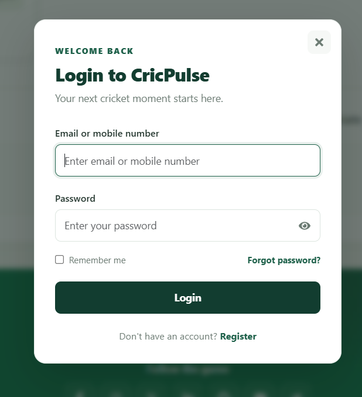
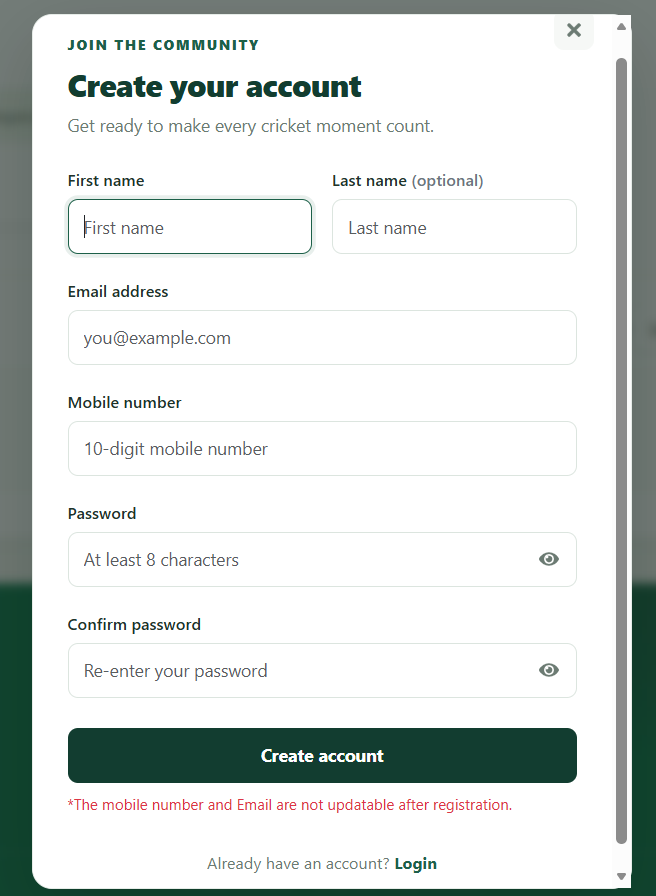
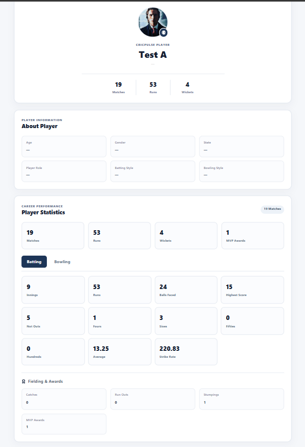
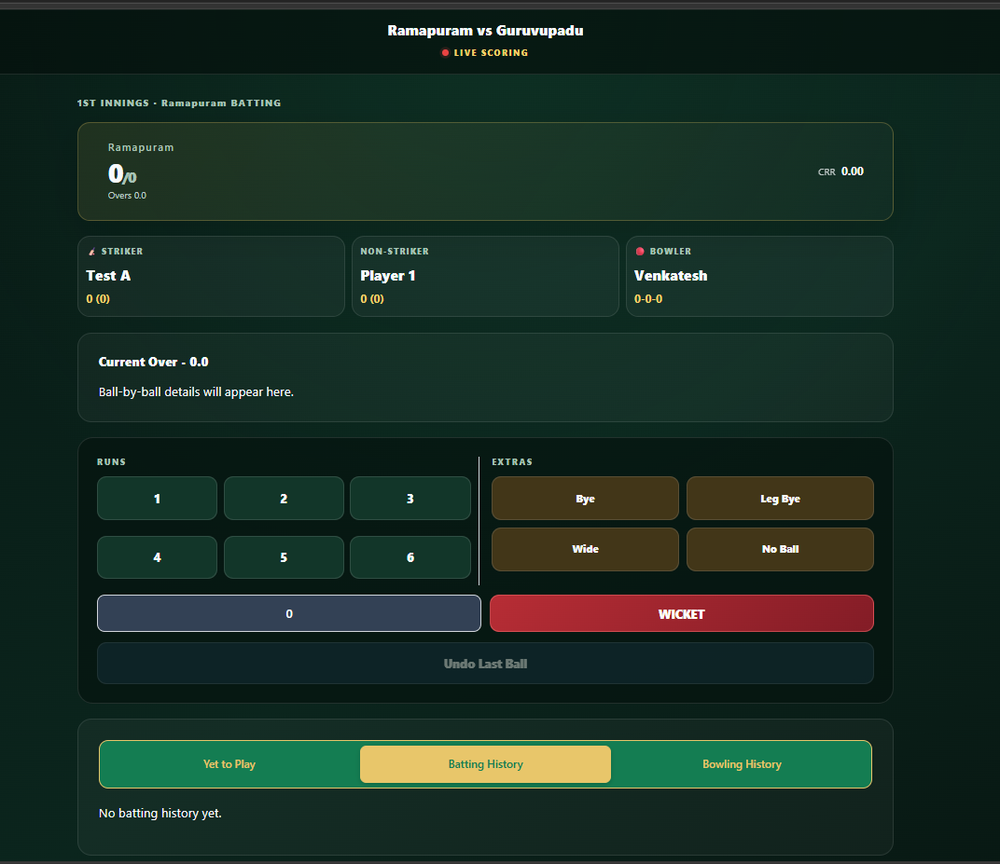
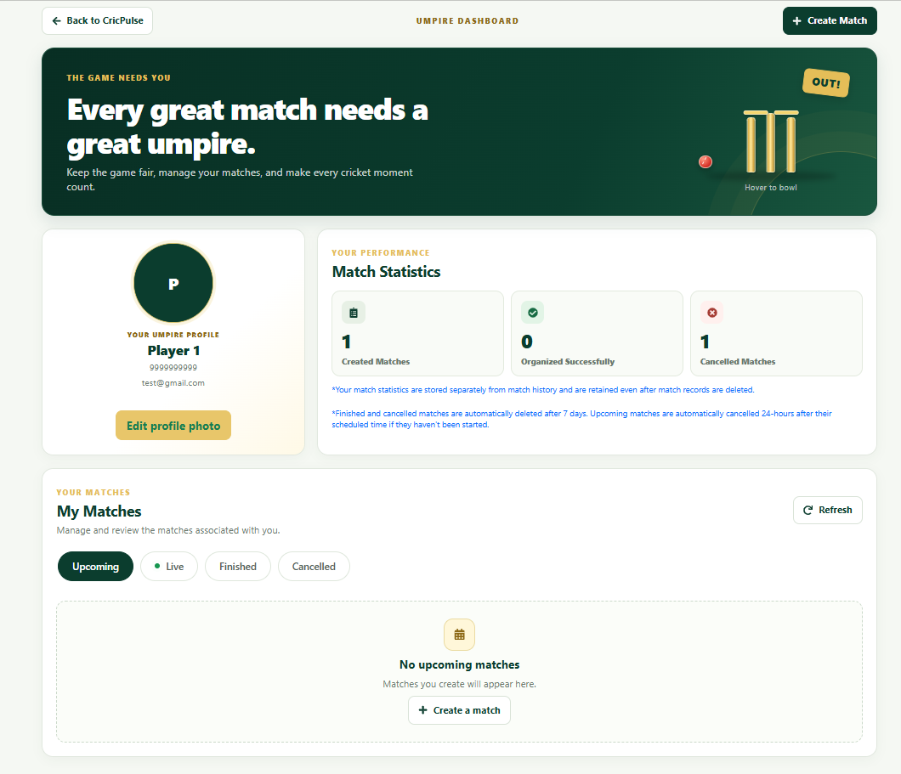
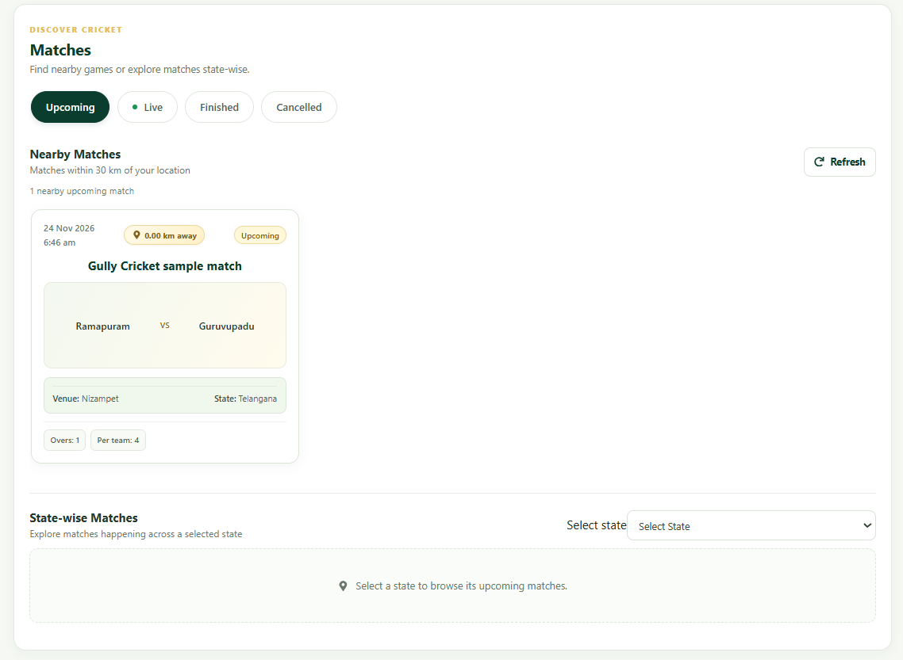
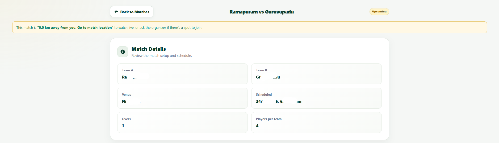
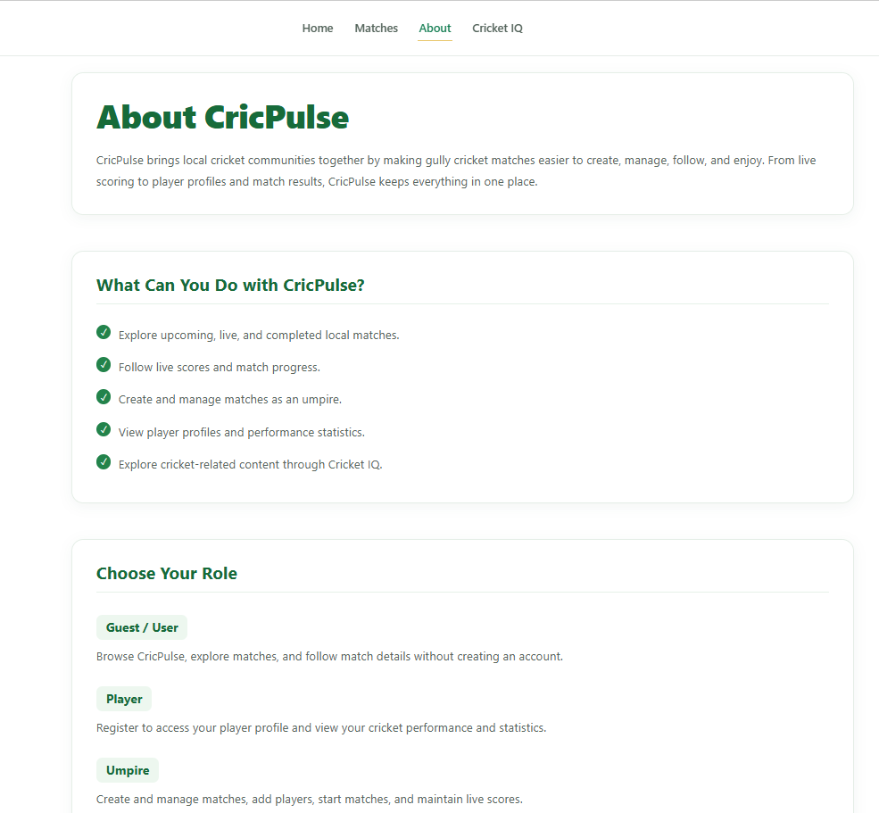
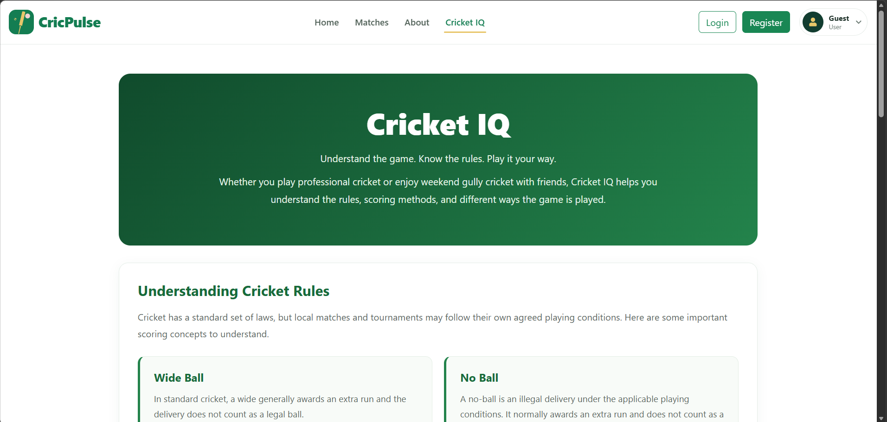

# CricPulse

CricPulse is a full-stack cricket scoring app for local and gully cricket.
Umpires can organize matches and score them ball by ball. Spectators can
follow live scorecards, discover nearby matches, and view player statistics.

## Live Demo

[Open CricPulse](https://cricpulse-roan.vercel.app/)

Start with **Matches** to browse scorecards. Allow location access to find
nearby matches and view directions when a venue link is available.

## Features
- **Account registration and sign-in** — Create a CricPulse account and sign in to manage your profile or access the umpire dashboard.
- **Match discovery** — Find matches within 30 km by allowing location access, or browse matches by state. Open Match Details for a nearby live or upcoming match to get Google Maps directions.
- **Match management** — Organize matches, set up innings, and manage matches from the umpire dashboard.
- **Ball-by-ball scoring** — Record runs, extras, and wickets, with support for undoing a scoring action.
- **Live scorecards** — Follow score updates without refreshing the page.
- **Nearby matches and directions** — Find local matches and open Google Maps from Match Details for nearby upcoming and live matches.
- **Player profiles** — View public player statistics and upload a photo from your own profile.
- **Umpire statistics** — View organized matches and umpiring statistics in the dashboard.

## Screenshots

### Login

Sign in to CricPulse to access your account and profile.



### Registration

Create a CricPulse account using the registration form.



### Public Player Profile & Stats

View a player’s profile photo, cricket role, and batting and bowling
statistics. Spectators can open this page without signing in.



### Umpire live scorecard



### Umpire dashboard



### Matches

Discover matches within 30 km of your location or browse games by state.



[Browse matches](https://cricpulse-roan.vercel.app/matches)

### Nearby match directions



### About CricPulse
Learn what CricPulse does and explore the spectator, player, and umpire roles.



[View About CricPulse](https://cricpulse-roan.vercel.app/about)

### Cricket IQ

Learn how wides, no-balls, byes, leg byes, and free hits affect scoring,
and how to undo the last ball in CricPulse.



[Explore Cricket IQ](https://cricpulse-roan.vercel.app/cricket-iq)

## Tech Stack

| Layer | Technologies |
|---|---|
| Frontend | React, Vite, React Router, Bootstrap, Axios |
| Backend | C#, ASP.NET Core Web API, .NET 8 |
| Database | Microsoft SQL Server, Entity Framework Core |
| Real-time updates | SignalR |
| Hosting | Vercel for the frontend, MonsterASP.NET for the API |

## Project Structure

| Folder | Purpose |
|----|----|
| `CricPulse-Frontend/` | React interface for spectators, players, and umpires |
| `CricPulse.API/` | HTTP endpoints, authentication, and the SignalR hub |
| `CricPulse.Application/` | Match, scoring, and profile workflows |
| `CricPulse.Domain/` | Domain entities |
| `CricPulse.Infrastructure/` | EF Core, repositories, and database migrations |

## Run Locally

You’ll need the .NET 8 SDK, Node.js 22.12 or newer, npm, SQL Server, and
the EF Core 8 CLI (`dotnet ef`).

### 1. Configure the database

Set `ConnectionStrings:DefaultConnection` for `CricPulse.API` using your
local SQL Server connection. Keep database credentials out of Git.

From the repository root, apply the migrations to your local database:

```powershell
dotnet ef database update --project CricPulse.Infrastructure --startup-project CricPulse.API
```

### 2. Start the API

From the repository root, run:

```powershell
dotnet dev-certs https --trust
dotnet run --project CricPulse.API --launch-profile http --urls "https://localhost:7066"
```

Swagger is available at `https://localhost:7066/swagger` in Development.

### 3. Start the frontend

Create `CricPulse-Frontend/.env.local` with:

```env
VITE_API_BASE_URL=https://localhost:7066/api
```

In a second terminal, run:

```powershell
cd CricPulse-Frontend
npm ci
npm run dev
```

Open `http://localhost:5173` or the URL printed by Vite.